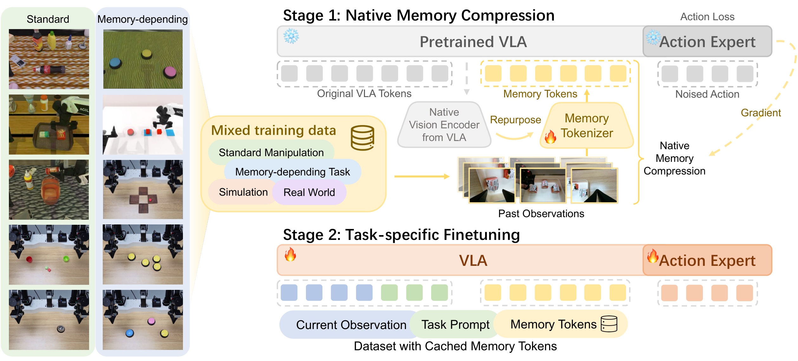

# NativeMEM

<div id="top" align="left">
  <a href="https://opendrivelab.com/NativeMEM"></a>
  <a href="https://arxiv.org/abs/2607.06678"></a>
  <a href="https://github.com/Ziyeeee/NativeMEM-RMBench"></a>
</div>

<p align="center">
  <a href="assets/method.png"></a>
</p>

NativeMEM equips a pretrained vision-language-action (VLA) policy with long-term, real-time-updated visual memory. Its Native Memory Compression scheme repurposes the VLA's own vision encoder to compress each historical frame-view observation into a single native memory token, then appends those tokens to the VLA's original input sequence.

This repository retains the upstream `openpi` Python package namespace for compatibility with the underlying model, training, and policy infrastructure.

The simulation evaluation lives in [NativeMEM-RMBench](https://github.com/Ziyeeee/NativeMEM-RMBench), which contains the memory-dependent manipulation tasks and a server-client evaluation mode for the NativeMEM policy. See that repository for more details.

## Method overview

NativeMEM training has three main steps:

1. **Native Memory Compression:** initialize the memory tokenizer from the VLA's native vision encoder, freeze the pretrained VLA, and train only the memory branch with the VLA's original action-prediction objective. Each frame-view pair is summarized into one action-aligned memory token.
2. **Memory caching:** run the learned memory tokenizer over target-task demonstrations and store the per-frame, per-view `mem_token` features in a LeRobot dataset.
3. **Task-specific finetuning:** retrieve the cached memory tokens, append them to the standard observation and prompt tokens, and finetune the VLA backbone, action head, memory projection, and memory beginning-of-sequence token. The memory-tokenizer encoder remains fixed.

The cached LeRobot feature is named `mem_token`. The Stage 2 data pipeline collects selected frame-view tokens into `Observation.memory` and produces the corresponding `Observation.memory_mask`.

## Setup

NativeMEM requires Python 3.11 and a CUDA-capable NVIDIA GPU for practical training. Install the environment with [`uv`](https://docs.astral.sh/uv/):

```bash
GIT_LFS_SKIP_SMUDGE=1 uv sync
```

Activate the environment before running any command in this README.
```bash
source .venv/bin/activate
export XLA_PYTHON_CLIENT_MEM_FRACTION=0.9
export HF_LEROBOT_HOME=$(pwd)/data
```

## Released checkpoints

Checkpoints are hosted at [Ziyeeee/NativeMEM](https://huggingface.co/Ziyeeee/NativeMEM/tree/main) with the same layout as this repository:

| Checkpoint | Path |
| --- | --- |
| Stage 1 pretrained memory tokenizer | `checkpoints/mem_tokenizer_pretrain/pretrain/49999/params` |
| Stage 2 task-specific NativeMEM policies | `checkpoints/nativemem_pi05/<task>/19999` |

Each Stage 2 checkpoint contains `params` and `assets`; the normalization statistics in `assets` are reloaded at evaluation.

```bash
hf download Ziyeeee/NativeMEM --include "checkpoints/mem_tokenizer_pretrain/pretrain/*" --local-dir .
hf download Ziyeeee/NativeMEM --include "checkpoints/nativemem_pi05/*" --local-dir .
```

With the Stage 1 checkpoint downloaded, Stage 1 training can be skipped: pass `checkpoints/mem_tokenizer_pretrain/pretrain/49999/params`.

## Prepare the data

All commands assume raw and converted datasets live under `data/` and normalization statistics under `assets/<dataset type>/norm_stats.json`.

### 1. Convert raw episodes to Stage 1 HDF5 and compute normalization assets

List the raw RoboTwin/RMBench-style `.../data` directories in a JSON file under one dataset type (`sim`, `trossen`, or `arx`); glob patterns are expanded:

```json
{"sim": ["data/RMBench/*/demo_clean/data"]}
```

One run writes all episodes into one HDF5 file and its normalization statistics to `<assets_dir>/<output stem>/norm_stats.json`:

```bash
python scripts/prepare_mem_tokenizer_h5.py \
    --sources data/sources.json \
    --output_path data/sim.h5 \
    --assets_dir assets             # -> assets/sim/norm_stats.json
```

Build one file per dataset type. Each output episode contains three JPEG camera streams, state, action, its instruction list (from `<task>/<demo>/instructions/episode<N>.json`), and a `dataset_type` attribute. When instruction JSON files are unavailable, provide fallback text with `--instruction_map`, repeated `--default_instruction TASK=TEXT`, or `--fallback_instruction`. The file is built in RAM and written once on close, so the host needs RAM for the whole output.

### 2. List the datasets in the training config

Set `datasets` of `mem_tokenizer_pretrain` in `src/openpi/training/config_mem_tokenizer.py`; each sample is normalized with the stats of the file it came from:

```python
datasets=(
    temporal_data.H5Dataset(path="data/sim.h5", norm_stats_dir="assets/sim"),
    temporal_data.H5Dataset(path="data/arx.h5", norm_stats_dir="assets/arx"),
),
```

## Stage 1: Train the memory tokenizer

```bash
python scripts/train_mem_tokenizer.py mem_tokenizer_pretrain \
    --exp_name=my_mem_tokenizer \
    --overwrite
```

## Stage 1.5: Extract memory tokens

Convert the raw episodes of each target task directly to a LeRobot dataset, extracting one `mem_token` per frame-view pair with the trained memory tokenizer:

```bash
python examples/robotwin/convert_raw_to_lerobot_mem_tokenizer.py \
    --data_dirs "data/RMBench/click_button/demo_clean/data" \
    --repo_id click_button_nativemem \
    --params_path checkpoints/mem_tokenizer_pretrain/my_mem_tokenizer/49999/params \
    --episode_num 50
```

Frames go through the same resize-with-pad and JPEG round trip as the Stage 1 HDF5, so the cached tokens see the same pixels as tokenizer training. `--episode_num` keeps the first N episodes (by episode id) of each data directory. Instructions are read as in Stage 1 data preparation, with the same `--instruction_map`, `--default_instruction`, and `--fallback_instruction` fallbacks. The resulting LeRobot dataset is stored under `$HF_LEROBOT_HOME/<repo_id>`, i.e. `data/<repo_id>`.

## Stage 2: Train NativeMEM

Before training, update the `NativeMEMWeightLoader` path in [`src/openpi/training/config_nativemem.py`](src/openpi/training/config_nativemem.py) to the Stage 1 `params` directory:

```python
weight_loader=weight_loaders.NativeMEMWeightLoader(
    "checkpoints/mem_tokenizer_pretrain/my_mem_tokenizer/49999/params"
)
```

The provided `nativemem_pi05` config targets simulated ALOHA data: it uses `gripper_type="sim"` and loads the normalization statistics written by data preparation step 1 from `assets/sim`. When training another robot type, update both the gripper type and normalization asset ID in the same config.

The same config maps `repo_id` prefixes to the maximum flattened memory length. Add a task prefix to `REPO_ID_MEMORY_MAX_LEN` when the dataset needs a value other than the model default. The first matching prefix wins.

Then launch Stage 2:

```bash
python scripts/train_nativemem.py nativemem_pi05 \
    --exp_name=my_nativemem \
    --data.repo_id=click_button_nativemem \
    --overwrite
```


## Repository layout

```text
scripts/prepare_mem_tokenizer_h5.py                         # Raw data -> Stage 1 HDF5 + norm stats
scripts/merge_mem_tokenizer_h5.py                           # Merge Stage 1 HDF5 shards
scripts/compute_norm_stats_h5.py                            # Compute HDF5 normalization statistics
scripts/train_mem_tokenizer.py                              # Stage 1 training entry point
examples/robotwin/convert_raw_to_lerobot_mem_tokenizer.py    # Raw data -> LeRobot with cached mem_token
scripts/train_nativemem.py                                  # Stage 2 training entry point
src/openpi/models/mem_tokenizer.py                          # Memory-tokenizer model
src/openpi/models/nativemem.py                              # NativeMEM policy model
src/openpi/training/config_mem_tokenizer.py                 # Stage 1 configuration
src/openpi/training/config_nativemem.py                     # Stage 2 configuration
```


## Acknowledgements

NativeMEM builds on the public [OpenPI](https://github.com/Physical-Intelligence/openpi) codebase and pi0.5 infrastructure. We thank the OpenPI authors and the broader open-source robotics community for making this work possible.

## License

See [`LICENSE`](LICENSE) and [`LICENSE_GEMMA.txt`](LICENSE_GEMMA.txt) for license information.
